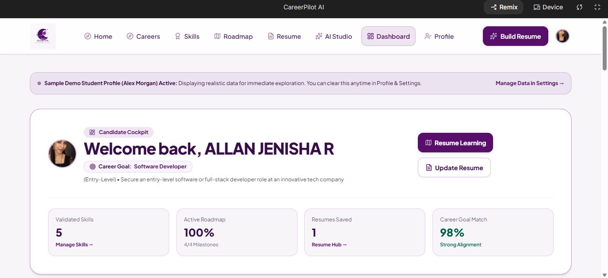
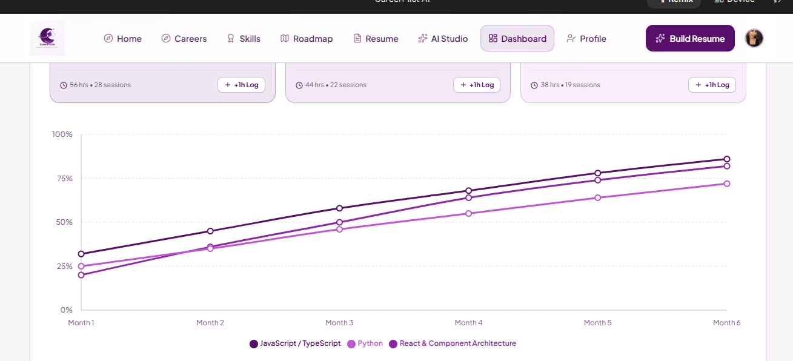
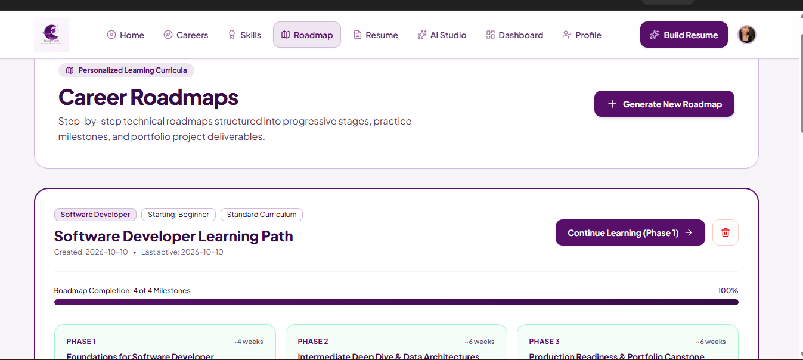
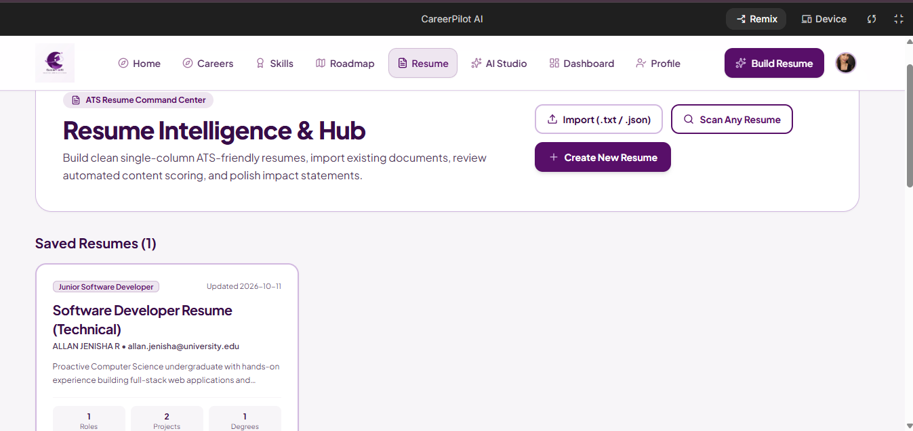
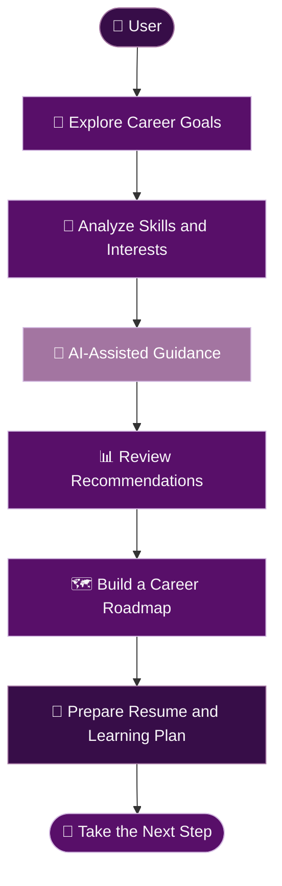

<div align="center">


<br/>


<br/>


<br/><br/>

<a href="https://github.com/AllanJenisha10/CareerPilot-AI">

</a>
<a href="https://ai.google.dev/">

</a>


<br/><br/>

**🎯 Discover · 🧠 Develop · 🗺️ Navigate · 🚀 Grow**

<br/>

*An AI-powered companion for your career journey.*

</div>

---

## 📑 Table of Contents

- [About the Project](#-about-the-project)
- [The Problem](#-the-problem)
- [Our Solution](#-our-solution)
- [Key Features](#-key-features)
- [Application Showcase](#-application-showcase)
- [How It Works](#-how-it-works)
- [Technology Stack](#️-technology-stack)
- [Brand Identity](#-brand-identity)
- [Getting Started](#-getting-started)
- [Security and Privacy](#-security-and-privacy)
- [Testing Checklist](#-testing-checklist)
- [Future Enhancements](#-future-enhancements)
- [Contributing](#-contributing)
- [License](#-license)

---

## ✨ About the Project

**CareerPilot AI** is an AI-powered career guidance platform designed to help college students, graduates, and early-career job seekers explore career opportunities, understand their skills, identify development areas, and plan their professional growth.

The platform aims to make career exploration more accessible through an intuitive interface and AI-assisted guidance powered by Google Gemini.

Rather than leaving career planning confusing and unstructured, CareerPilot AI aims to turn it into a clearer journey with achievable steps.

<div align="center">

| 🎯 Discover | 🧠 Analyze | 🗺️ Plan | 🚀 Grow |
|:---:|:---:|:---:|:---:|
| Explore career paths | Understand your skills | Organize learning goals | Move toward your ambitions |

</div>

### 🌟 Our Mission

To make career exploration and skill development clearer, more approachable, and more personalized through AI-assisted guidance.

> Your career is a journey, not a destination. Take the first step, build your skills, and shape your future.

---

## 🎯 The Problem

Students and early-career professionals may face challenges such as:

- Difficulty identifying suitable career paths.
- Limited understanding of the skills required for target roles.
- Uncertainty about what to learn next.
- Challenges preparing and improving resumes.
- Difficulty organizing career goals into actionable steps.
- Information spread across multiple platforms and resources.

## 💡 Our Solution

CareerPilot AI aims to bring career exploration and preparation into one convenient platform.

It focuses on:

- Exploring career possibilities.
- Understanding current skills and development needs.
- Planning learning activities.
- Organizing career goals into roadmaps.
- Improving resume preparation.
- Using AI to support career-related decisions.

AI-generated suggestions should be treated as guidance, not guarantees of employment or career success.

---

## 🚀 Key Features

<div align="center">

| Feature | Description |
|:---|:---|
| 🎯 **Career Recommendations** | Explore potential career paths based on interests, goals, and available user information. |
| 🧠 **Skill Analysis** | Review existing skills and identify potential areas for development. |
| 📊 **Skill-Gap Analysis** | Understand how current skills compare with those needed for a target career. |
| 🗺️ **Career Roadmap** | Organize learning and career-development goals into manageable steps. |
| 📄 **Resume Assistance** | Receive AI-assisted guidance for resume content and presentation. |
| 🤖 **Gemini AI Integration** | Support career-related interactions with Google's generative AI technology. |
| 📱 **User-Friendly Interface** | Present career-related information through a structured interface. |
| 🌱 **Growth-Oriented Guidance** | Encourage continuous learning, exploration, and professional development. |

</div>

*Feature descriptions should reflect the functionality currently implemented in the application.*

---

## 🎬 Application Showcase

Explore the main CareerPilot AI interfaces.

<div align="center">

### 📊 Dashboard & Analytics



<br/><br/>

### 🧠 Skill Analysis



<br/><br/>

### 🗺️ Career Roadmap



<br/><br/>

### 📄 Resume Assistance



</div>

---

## 🔄 How It Works

<div align="center">



</div>

*This diagram illustrates the intended user journey; the exact flow depends on the features available in the current application.*

---

## 🛠️ Technology Stack

<div align="center">


</div>

### Core Tools

| Technology | Purpose |
|:---|:---|
| **Google AI Studio** | AI-assisted application development and prototyping. |
| **Google Gemini** | Generative AI capabilities, where integrated into the application. |
| **GitHub** | Source-code hosting, version control, and project documentation. |

*Add the exact frontend framework, programming languages, libraries, and deployment platform used by your project after confirming them in its configuration files.*

---

## 🎨 Brand Identity

CareerPilot AI uses a visual identity designed to communicate empowerment, innovation, clarity, transparency, and growth.

### 🌈 Official Colour Palette

<div align="center">

| Colour | Preview | Hex Code | Suggested Use |
|:---|:---:|:---:|:---|
| **Deep Indigo** | 🟪 | `#580F69` | Primary brand colour and key accents |
| **Blackberry Purple** | 🟪 | `#370D48` | Dark backgrounds and depth |
| **Smoky Purple** | 🟪 | `#A375A1` | Secondary accents and supporting elements |
| **Chalk White** | ⬜ | `#F7F5F8` | Light surfaces and readable content |
| **Thistle Purple** | 🟪 | `#D2B9E0` | Highlights and soft supporting surfaces |

</div>

### ✍️ Typography

- **Primary typeface — Space Grotesk:** Brand headings, page titles, and prominent visual elements.
- **Secondary typeface — DM Sans:** Body text, navigation, forms, buttons, and supporting content.

### 💜 Brand Values

- **Empowerment:** Encourage users to take ownership of their career journeys.
- **Innovation:** Apply AI thoughtfully to modern career exploration.
- **Clarity:** Make career-related information easier to understand.
- **Transparency:** Communicate recommendations and limitations honestly.
- **Growth:** Support continuous learning and professional development.

### 🖼️ Visual Direction

- Tech-forward precision.
- Human-centric guidance.
- Futuristic clarity.
- Structured minimalism.
- Empowered growth.

### 📐 Logo Guidelines

- Preserve the original logo's proportions.
- Maintain clear space around the logo.
- Avoid stretching, distortion, and unnecessary effects.
- Use backgrounds that preserve logo visibility and contrast.
- Follow the official brand book's minimum-size guidance.

---

## 🎯 Project Objectives

1. Make career exploration more accessible.
2. Help users discover potential professional pathways.
3. Identify skills and areas for improvement.
4. Encourage structured learning and development.
5. Support resume preparation and career readiness.
6. Present career-related guidance through a clear interface.
7. Encourage informed, user-led career decisions.

---

## ⚙️ Getting Started

The exact setup procedure depends on the frameworks and scripts included in the repository.

### Prerequisites

- Git installed on your computer.
- A modern web browser.
- The runtime and package manager required by the project.
- A Google Gemini API key if the application requires one.

### 1. Clone the Repository

```bash
git clone https://github.com/AllanJenisha10/CareerPilot-AI.git
```

### 2. Open the Project Directory

```bash
cd CareerPilot-AI
```

### 3. Install Dependencies

Inspect the repository's configuration files to identify the correct package manager and installation command.

For example, if the project contains a `package.json` file, follow the scripts and dependency instructions defined in that file.

### 4. Configure Environment Variables

If the application requires an API key, configure it using the environment-variable mechanism supported by your development environment and deployment platform.

**Security reminder:** Never commit API keys, passwords, or private credentials to GitHub. Use server-side secrets or the secure configuration mechanism appropriate to your application.

### 5. Run the Application

Use the development or start command specified by your project's configuration files.

### 6. Verify the Application

- Open the application in your browser.
- Navigate through the available pages.
- Test the implemented career and skill features.
- Verify AI functionality if configured.
- Check the layout at different screen sizes.

---

## 🔐 Security and Privacy

CareerPilot AI should follow responsible development practices:

- Keep API credentials private.
- Avoid exposing sensitive keys in publicly accessible frontend code.
- Handle API errors and rate limits gracefully.
- Avoid collecting unnecessary personal information.
- Validate user inputs.
- Explain AI-generated recommendations as suggestions rather than guaranteed outcomes.
- Review any external service's privacy practices before sending user data.

---

## 🧪 Testing Checklist

Use this checklist to track project testing.

- [ ] Application starts successfully.
- [ ] Navigation links work correctly.
- [ ] Dashboard displays the expected information.
- [ ] Career recommendation functionality works.
- [ ] Skill analysis displays correctly.
- [ ] Skill-gap analysis works, if implemented.
- [ ] Career roadmap functionality works.
- [ ] Resume assistance works.
- [ ] Gemini API errors are handled appropriately, if integrated.
- [ ] No private API keys are exposed.
- [ ] Screenshots match the current application.
- [ ] Layout is usable on supported screen sizes.
- [ ] Text, charts, and controls remain readable.

---

## 🌱 Future Enhancements

Potential improvements for future versions include:

- Personalized learning recommendations.
- Career and skill progress tracking.
- Job and internship discovery.
- More detailed resume feedback.
- Improved accessibility.
- Multilingual career guidance.
- Personalized learning milestones.
- More transparent AI recommendations.
- Expanded career exploration resources.

*These are possible future enhancements, not claims about existing functionality.*

---

## 🤝 Contributing

Suggestions, bug reports, and improvements are welcome.

If you plan to contribute:

1. Review the existing project structure.
2. Identify a specific improvement.
3. Test your changes.
4. Avoid committing private credentials.
5. Document significant changes clearly.

---

## 📄 License

A license has not been specified here. If you intend to distribute CareerPilot AI as an open-source project, choose an appropriate license and add a corresponding `LICENSE` file to the repository.

---

<div align="center">

## 🚀 Your Future Starts with a Plan


<br/>

**CareerPilot AI**

*Navigate Your Career. Shape Your Future.*

<a href="https://github.com/AllanJenisha10/CareerPilot-AI">

</a>

<br/><br/>

<sub>Empowerment · Innovation · Clarity · Transparency · Growth</sub>

<br/><br/>


</div>
